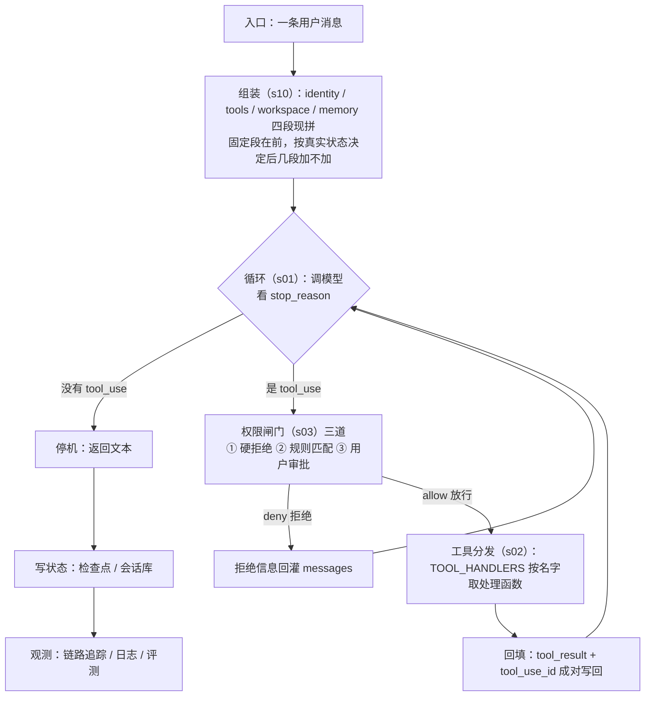

# D1 — 总纲 + L4a 运行时内核（循环与 Harness）

> 日期：2026-09-18（周五）；14:52 开工，15:00 起跑，23:00 停机。
> 当日面试锚：逐层讲六层（L1-L6）；讲「一条用户消息的一生」；手写一次 ReAct 循环。
> 覆盖：总纲（L1-L6 全览）+ L4a（循环与 Harness 内核）。
> 主阅读：`00-我的深度整合专题\循环工程深度解析\Loop_Engineering_Deep_Dive.md`（945 行，含 📍溯源节）；源文三份在 `09-loop-engineering\` 下，只在标注 `↳深挖` 处回查。

---

## 本日文件核验

| 路径 | 状态 | 行数/大小 | 备注 |
|:--|:--:|:--|:--|
| `00-我的深度整合专题\Agent面试5日冲刺\README.md` | ✅ | 260 | v2 六层版总纲 |
| `00-我的深度整合专题\循环工程深度解析\Loop_Engineering_Deep_Dive.md` | ✅ | 945 | 三文蒸馏，总（全文地图）→ 分（三层）→ 查（附录） |
| `09-loop-engineering\01.context-looop-engineering.md` | ✅ | 484 | 文件名拼写 looop（三个 o） |
| `09-loop-engineering\02.loop-engineering.md` | ✅ | 445 | |
| `09-loop-engineering\03.loop-engineering.md` | ✅ | 424 | |
| `01-Agent\02-Agent_react\Readme.md` | ✅ | 154 | |
| `01-Agent\02-Agent_react\agent\loop.py` | ✅ | 55 | 写码挑战①的对照物 |
| `01-Agent\02-Agent_react\agent\types.py` | ✅ | 9 | 消息与工具调用的类型定义 |
| `01-Agent\02-Agent_react\agent\tools\` | ✅ | 4 文件（24/36/12/6） | 注册表 + 3 个工具 |
| `06-harnes\learn-claude-code\s01_agent_loop\README.md` / `06-harnes\learn-claude-code\s01_agent_loop\code.py` | ✅ | 207 / 137 | 最小循环 |
| `06-harnes\learn-claude-code\s02_tool_use\README.md` / `06-harnes\learn-claude-code\s02_tool_use\code.py` | ✅ | 222 / 190 | 工具分发 |
| `06-harnes\learn-claude-code\s10_system_prompt\README.md` | ✅ | 254 | 已读 |
| `06-harnes\learn-claude-code\s03_permission\README.md` | ✅ | 232 | 已读 |
| `01-Agent\02-Plan-and-Execute\Readme.md` | ✅ | 363 | |
| `01-Agent\03-Reflexion\Readme.md` | ✅ | 187 | 目录名含连字 fl（U+FB02），照原路径复制 |
| `01-Agent\04-LATS\Readme.md` | ✅ | 242 | |
| `01-Agent\05-Multi-Agent-Crew\Readme.md` | ✅ | 149 | |
| `01-Agent\01-small-llm-function-call-project\README.md` | ✅ | 171 | function calling 变体 |
| `00-大纲\Agent教学大纲.md` | ✅ | 44 | 作者序，仅作对照 |

---

## 时间盒

| 时段 | 动作 | 内容 | 产出 |
|:--|:--|:--|:--|
| 15:00-15:30 | 启动 · 总纲 | 冲刺 `README.md` §1 六层总图 + §3 五日总览；手抄六层表 | 六层总纲表（骨架） |
| 15:30-17:15 | 概念 | `00-我的深度整合专题\循环工程深度解析\Loop_Engineering_Deep_Dive.md`（945 行）全读；先看全文地图，再看「冲突与判断」 | 四层演进能口述 |
| 17:15-18:05 | 对照 | `01-Agent\02-Agent_react\Readme.md` + `agent\loop.py`（55 行逐行）+ `agent\types.py` + `agent\tools\__init__.py` | 真实 loop 结构笔记 |
| 18:05-18:20 | 休息 | | |
| 18:20-19:05 | 写码挑战① | 见下 | 差异点笔记 |
| 19:05-20:00 | 晚饭 | | |
| 20:00-20:40 | 机制 | `06-harnes\learn-claude-code\s01_agent_loop\`（README 207 + code.py 137）+ `06-harnes\learn-claude-code\s02_tool_use\`（README 222 + code.py 190） | 循环与工具分发笔记 |
| 20:40-20:45 | 休息 | | |
| 20:45-21:35 | 范式 | `01-Agent` 其余 6 份自述与各自控制流：`00-llm_function_call`(334)、`01-small-llm-function-call-project`(171)、`02-Plan-and-Execute`(363)、`03-Reflexion`(187)、`04-LATS`(242)、`05-Multi-Agent-Crew`(149) | 五范式对比表 |
| 21:35-22:05 | 机制 | `06-harnes\learn-claude-code\s03_permission\`（232）+ `06-harnes\learn-claude-code\s10_system_prompt\`（254） | 权限闸门与 system prompt 组装笔记 |
| 22:05-23:00 | 整合 | 补全六层总纲表（先填 L4 行）+ 生命周期总图 v1 + 面试卡 7 问自答 + 录 3 问口述 | 本文件产出区 |

---

## 写码挑战①（18:20-19:05，45 分钟，闭卷）

合上电脑，用 Python 伪代码重写最小 ReAct 循环（10-20 行），需要覆盖的内容：

```
while 循环 ｜ messages 累积 ｜ LLM 调用 ｜ 解析 tool_call ｜ 执行 tool ｜ tool_result 回填 ｜ 无 tool_call 时返回
```

函数名可凭记忆书写，结构不得照抄。写完对照 `01-Agent\02-Agent_react\agent\loop.py`，把差异点记进笔记。差异点就是漏掉的机制，通常是停止条件、最大轮数、错误处理，以及 `tool_call` 与 `tool_result` 的配对。

---

## 面试卡（当日自答的 7 问，答题稿见下文产出区 ④）

1. 六层逐层是什么？每层选了什么，为什么排除另一个？
2. 一条用户消息从进入系统到返回，经过哪些阶段？说出 harness 的职责：组装、循环、工具、权限、回填、停机。
3. 手写 ReAct 循环；停止条件怎么定（最大轮数、无 `tool_call`、超时、预算）？
4. harness 与 agent 框架的区别是什么？为什么需要 harness（权限、工具、可观测、回滚）？
5. 五范式演进：function calling → ReAct → Plan-and-Execute → Reflexion → LATS，各自解决什么问题？面试场景怎么选？
6. 工具调用协议有几种（原生 tools JSON、注册中心、手写 Action 文本协议）？各自取舍是什么？
7. L4 为什么必须讲成同层二选一？把它讲成上下两层会导致什么工程错误？

---

## 晚间复盘 3 问（附答案，D2 开场闭卷口述）

**1. 用不超过 5 步讲「一条用户消息的一生」。**

① 组装：每轮现场拼系统提示词的四段——身份、工具、工作目录、记忆。固定段放在前面，后几段按真实状态决定加不加。
② 调模型：把消息列表交给模型，读回 `stop_reason`。
③ 权限与工具：`stop_reason` 为 `tool_use` 时，先过硬拒绝、规则匹配、用户审批三道闸；放行后用注册表按工具名取处理函数执行，被拒绝则把拒绝信息回灌。
④ 回填：工具结果连同 `tool_use_id` 成对写回消息列表，回到第 ② 步。
⑤ 停机与落盘：没有 `tool_use` 就返回文本，状态写检查点，轨迹进观测。

**2. harness 与「直接 while 调 LLM」差在哪三处？**

① 工具执行前的权限闸门。黑名单不够用，需要规则匹配加人工审批。
② 每轮现场拼装的上下文，还要照顾提示词缓存，固定段在前、动态段在后。
③ 循环之外的可观测与可恢复：链路追踪、结构化日志、检查点，会话能接续。

`while` 加一次模型调用解决的是循环本身，这三处决定这个循环能不能上生产。

第 ② ③ 两处与产出区 ④ 的 Q4 讲的是同一件事，本节是口述用的短版本。

**3. 五范式各比上一个多解决了什么？**

- function calling：单步工具调用的参数能可靠解析成结构化数据。
- ReAct：把想、做、看串成环，多步推理与工具调用能交替进行。
- Plan-and-Execute：先出计划再逐步执行，长任务有了结构分解；代价是计划会过期，难以自适应。
- Reflexion：失败后自我批判再试一次，质量能迭代；代价是多一轮模型开销。
- LATS：把多路径探索做成树搜索加打分，能处理决策空间大的任务；代价是算力高。
- Multi-Agent-Crew：多角色分工协作，换取并行与专长；代价是编排复杂度上升。它不在这条演进链上，属于多体协作那条路。

按循环拓扑看，前面五个是同一件事的不同形态：无环直线、单环、直线加外层重规划环、双层环、树。判别标准是有回跳且设了上限才算循环，只有补救而没有回跳的属于管线。

---

## 今日产出区

### ① 六层总纲表

| 层 | 我选什么 | 为什么不选另一个 | 本仓库实证文件 | 面试答法 |
|:--:|:--|:--|:--|:--|
| L6 界面 | 只做最小人工介入（HITL）界面：审批与澄清能回传即可 | 自研界面属前端工程，对 RAG/Agent 岗不加分，成本最高 | `11-langgraph\02-Agentic-Chatbot-using-LangGraph\frontend\hitl.py`、`12-hermes-agent-small\waku\gateway\` | 界面层只做最小可验收的人工审批，界面本身不自研。 |
| L5 观测 | 链路追踪（trace）用现成集成加本地结构化日志；评测用一小套 LLM 打分的回归集 | 自建追踪存储是重复造轮子；只看滚动日志定位不到是哪一步坏的 | `08-hermes-agent\03-eval`、`12-hermes-agent-small\waku\ops\` | 观测分三样：追踪看一步到一步，日志看现场，评测看回归，先用现成的。 |
| L4 运行时 | 两条都讲得清、都能上手；一个系统里只留一条编排骨架，本仓库演示项目选 LangGraph 做骨架，Hermes 的分层记忆与人设以模块形式挂上去 | 不在同一个系统里叠两套骨架（两条心跳抢同一份对话记录，状态分裂）；也不用 Hermes 当骨架（它是完整系统，拿它当骨架等于放弃图上的审批、分支与状态管理） | `11-langgraph`、`08-hermes-agent`、`12-hermes-agent-small`、`13-pi-agent`、`14-deepseek-harness` | LangGraph 和 Hermes 同层，解决的是同一类问题。一个系统里骨架只选一条：业务编排用 LangGraph（多步、审批、状态），Hermes 的记忆分层以模块形式挂上去。 |
| L3 动作 | 注册表分发（工具名到处理函数的字典）加原生 tools JSON 协议 | 不用手写 Action 文本协议（字符串解析脆弱，属 ReAct 教学版做法）；不写死 if/else | `06-harnes\learn-claude-code\s02_tool_use\README.md`、`08-hermes-agent\hermes-study\tools\registry.py` | 工具层用注册表分发，协议用原生 JSON；文本协议只用来理解原理。 |
| L2 上下文 | 三层：常驻的规则与人设、按需检索的长期记忆、当前会话流水；状态存检查点（checkpoint） | 不做全量塞入提示词（prompt），词元（token）会爆炸，各段还会互相干扰 | `02-RAG`、`03-memory`、`08-hermes-agent\07-mem-provider\README.md` | 上下文分常驻、按需检索、当前流水三层；写入过闸，读取按需。 |
| L1 推理 | 按请求路由模型：便宜模型干常规活，贵模型兜底；分类与抽取用本地小模型 | 不把所有请求都送去最强模型（成本与延迟都不划算） | `05-model-route`、`07-llm_from_scrach` | 推理层回答的是这个请求值不值得用贵模型。 |

### ② 生命周期总图 v1



四篇源文在流程里的落点：s10 在组装段，s01 在循环段，s03 在权限闸门，s02 在工具分发。

### ③ 五范式对比表

| 范式 | 一句话机制 | 解决什么 | 代价/局限 | 出处（路径+行数） |
|---|---|---|---|---|
| function calling | 模型原生输出结构化工具参数 | 单步工具调用可靠解析 | 只单步，无多轮推理 | `01-Agent\00-llm_function_call.py`(334) / `01-small-llm-function-call-project`(171) |
| ReAct | 思考-行动-观察循环 | 多步推理 + 工具结合 | 无规划、可能绕圈 | `01-Agent\02-Agent_react`(Readme 154 / loop.py 55) |
| Plan-and-Execute | 先出计划再逐步执行 | 长任务结构分解 | 计划过期、无法自适应 | `01-Agent\02-Plan-and-Execute`(363) |
| Reflexion | 失败后自我批判再试 | 从错误中迭代 | 额外 LLM 开销 | `01-Agent\03-Reflexion`(187) |
| LATS | 树搜索 + 反思打分 | 复杂决策空间探索 | 成本高 | `01-Agent\04-LATS`(242) |
| Multi-Agent-Crew | 多角色分工协作 | 并行 / 专长 | 编排复杂度 | `01-Agent\05-Multi-Agent-Crew`(149) |

### ④ 面试卡 7 问的答题稿

**Q1 六层逐层是什么？每层选了什么、为什么排除另一个？**

从 L1 开始逐层说。L1 推理按请求路由模型，回答的是这个请求值不值得用贵模型，其余交给便宜模型或本地小模型。L2 上下文分三层：常驻的规则与人设、按需检索的长期记忆、当前会话流水，状态存检查点。L3 动作是工具层，用注册表分发加原生 JSON 协议。L4 运行时是今天的重点：LangGraph 和 Hermes 同层，两条我都讲得清、都能上手，但一个系统里只留一条骨架——这里用 LangGraph 做编排，Hermes 的记忆分层以模块形式挂上去。L5 观测拆三样：链路追踪、日志、评测。L6 界面只做最小的人工审批界面。

**Q2 一条用户消息从进入系统到返回，经过哪些阶段？**

组装、循环、权限、回填、停机五步。① 组装：每轮现场拼系统提示词的四段（身份、工具、工作目录、记忆），固定段放前面，后几段按真实状态决定是否加入。② 循环：调模型，看停止原因。③ 模型要求调用工具时先过权限三道闸（硬拒绝、规则匹配、询问用户），放行才执行。④ 执行结果连同工具调用编号成对回灌消息列表，回到第 ② 步。⑤ 模型不再要求工具即停机，状态写入检查点，最后进观测。权限校验与上下文组装是 harness 的职责，循环负责的是下一轮是否开启。

**Q3 手写 ReAct 循环，停止条件怎么定？**

主体是：未超上限就调模型，解析出思考、行动与行动输入，有行动就执行并把观察追加进历史，有最终答案就返回，否则回到开头。停止条件分四类：主观的（模型给出最终答案）、客观的（最大轮数）、资源的（超时与词元预算）、异常的（连续同一个动作没有进展）。另有一条纪律：工具调用与工具结果必须用编号成对出现，少一条下一轮可能收到 400。

**Q4 harness 与 agent 框架的区别？为什么需要 harness？**

框架提供图、节点、状态这些零件；harness 负责循环之外的事。与直接写一个 while 调模型相比，差三处：① 工具执行前的权限闸门，黑名单不够用，要能规则匹配加人工审批；② 每轮现场拼装的上下文，还要照顾缓存（固定段在前）；③ 循环之外的可观测与可回滚：追踪、日志、检查点，会话能接续。这三处决定了循环能不能上生产。

**Q5 五范式演进，各自解决什么？面试场景怎么选？**

面试常说的五范式是 function calling → ReAct → Plan-and-Execute → Reflexion → LATS；Crew 是另一条路（多体协作），不在这条演进链上。按循环拓扑看，它们是同一件事的不同形态：无环直线（function calling）→ 单环（ReAct）→ 直线加外层重规划环（Plan-and-Execute）→ 双层环（Reflexion，内层执行加外层反思重试）→ 树（LATS，选择、展开、评估、回传）；Crew 是多环。场景选择：单步调用用 function calling；工具型多步用 ReAct；长任务需要先拆解用 Plan-and-Execute；对质量有要求、要能从错误里恢复用 Reflexion；决策空间大且算力可接受用 LATS。判别标准：有回跳且设了上限才算循环，只有补救而没有回跳属于管线。

**Q6 工具调用协议有几种，各自取舍？**

原生 tools JSON：协议由模型侧保证，参数结构化、解析可靠，代价是绑定模型能力。注册表分发：工具名到处理函数的字典，工程侧可插拔，增加工具不必改循环，代价是参数结构要自己维护，还要处理未知工具。手写 Action 文本协议：提示词里约定思考、行动、行动输入格式，再字符串解析，模型无关且直观，代价是脆弱——模型多写一个字，或同一条回复里既给最终答案又给行动，都会解析失败。生产环境用前两种组合，文本协议只用来理解原理。

**Q7 L4 为什么必须讲成「同层二选一」？讲成上下两层会导致什么工程错误？**

两者解决的是同一类问题：消息进来、拼上下文、调模型、判断是否调工具、执行、回灌、终止。仓库里 `08-hermes-agent\09-lang-serial-not\README.md` 写明「两条编排路径：概念等价、实现不同」，Hermes 也不依赖 LangGraph。「会」与「叠」是两件事：两条都能讲、都能上手，属于能力；一个系统里只能有一条骨架，属于约束。画成上下两层会让人以为可以叠起来互相补，结果就是两条心跳抢同一份对话记录、状态分裂——一个往 LangGraph 的检查点写，一个往会话库写，当前状态说不清。正确做法是骨架选一条，另一条的能力以工具或中间件的形式挂上去。

---

## D1 收尾报告（2026-09-18）

### 一、完成情况

| 时段 | 内容 | 状态 |
|:--|:--|:--:|
| 15:00-15:30 | 启动：六层总图与手抄六层表 | 完成 |
| 15:30-17:15 | 概念：`00-我的深度整合专题\循环工程深度解析\Loop_Engineering_Deep_Dive.md`（945 行）全读 | 完成 |
| 17:15-18:05 | 对照：`01-Agent\02-Agent_react\Readme.md`（154）+ `agent\loop.py`（55）逐行 | 完成 |
| 18:20-19:05 | 写码挑战①：闭卷重写最小 ReAct 循环 | 完成，已批改 |
| 20:00-20:40 | 机制：s01（README 207 / code.py 137）+ s02（README 222 / code.py 190） | 完成 |
| 20:45-21:35 | 范式：六份自述与控制流取证 | 完成 |
| 21:35-22:05 | 机制：s03_permission（232 / code 251）+ s10_system_prompt（254 / code 218） | 完成 |
| 22:05-23:00 | 整合：产出区 ①②③④ 全部填写 | 完成 |

### 二、产出文件

`00-我的深度整合专题\Agent面试5日冲刺\day1-loop-harness.md`，即本文件。当日产出为产出区的四件：六层总纲表、生命周期总图、五范式对比表、面试卡 7 问的答题稿；本文件另承载晚间复盘 3 问及其答案。

### 三、行数核验

口径为 `[System.IO.File]::ReadAllLines(<路径>).Count`（含空行）。本日实测 16 行，与卡片登记一致：334 / 171 / 154 / 55 / 9 / 24·36·12·6 / 363 / 187 / 242 / 149 / s01 207·137 / s02 222·190 / s03 232 / s10 254 / `00-大纲\Agent教学大纲.md` 44。

另一条工具坑记在此备查：裸 `(Get-Content <路径>).Count` 在中文 Windows 下按 GBK 解码 UTF-8 文件，会同时出现乱码与少算行数（同一个文件 313 对 334），不能作为核验口径。

### 四、遗留事项

1. `核验脚本.py` 未复跑。`pwsh` 全程报 `SetNamedSecurityInfoW failed (Win32 5): grantWrite(E:\AI_resource\AI-Engineer-from-scrach-main)`，沙箱无法给工作区设置权限；当日核对改用 `read` 与 `glob` 工具完成，结论有效。
2. GitHub 有两条提交（`932fdcc`、`12215d1`）在收尾时尚未推送，gitee 已同步。
3. 记忆 Tab 中若干关键记忆待确认。

### 五、D2 预告

D2 = L2 上下文层（记忆与知识）：跑 `03-memory` 三因子与长时记忆；读 hermes 四层记忆与 mem-provider；Mem0 详解；waku 四层与 gate；pi 会话树；LangGraph 检查点；`02-RAG` 主线与 Agentic RAG。产出：记忆对照表（含 mem0 与宿主机两列）、RAG 十步管线卡、边界卡，写码挑战②，填 `day2-context.md`。
